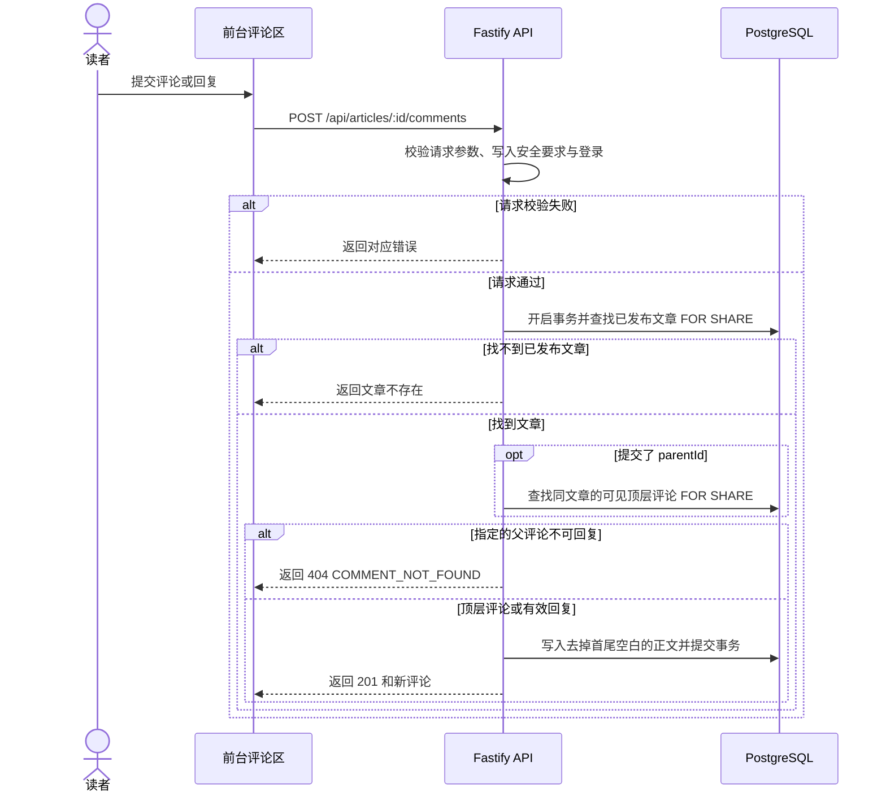

# 码栈数据库与评论流程图

- [核心关系总览](./database-overview.svg)保留用户、内容、评论、分类、收藏、关注和通知。字段、枚举以及会话、点赞、审核、签到和阅读计数辅助表在完整图中查看。
- [完整数据库关系图](./database-erd.svg)包含 Prisma 模型、字段、枚举和关系。

两张图均从[当前 Prisma schema](../../prisma/schema.prisma)生成。修改模型后运行 `npm run db:diagram` 更新。业务模块新增或拆分时，检查总览的筛选范围。

文章与沸点的回复关系由外键和 [SQL 触发器](../../prisma/migrations/202611250020_comment_thread_integrity/migration.sql)共同约束。触发器要求回复指向同一内容下的顶层评论。两套评论的父评论删除策略不同，文章使用 `Restrict`，沸点使用 `Cascade`。评审删除策略时需同时核对审核记录保留要求和实际删除入口。

[按模块查看泳道、流程与中英双语数据表图](./modules/README.md)。

## 文章评论写入时序

来源为[文章评论写入路由](../../apps/api/features/community/interactions.ts#L44)。

评论接口或事务规则变更时，按路由更新时序图。
