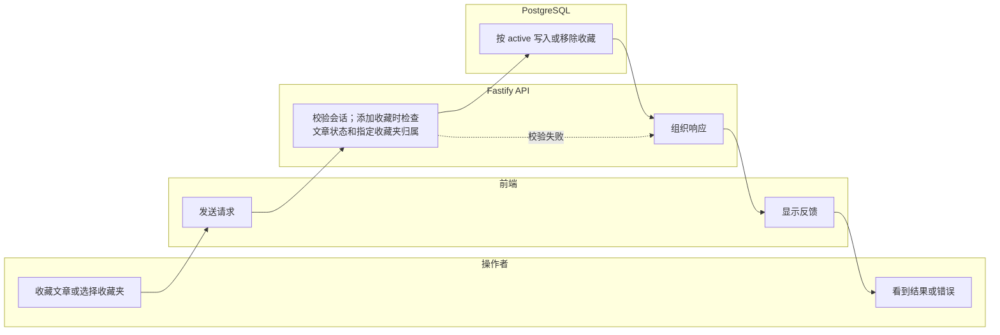
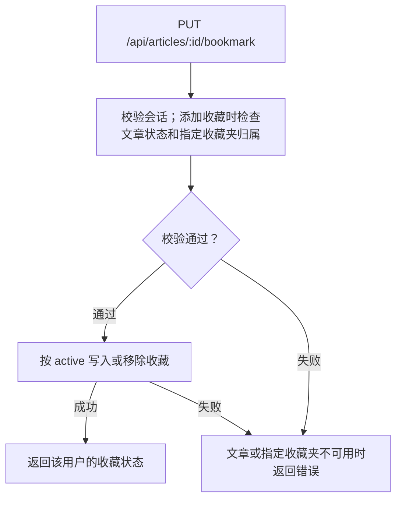
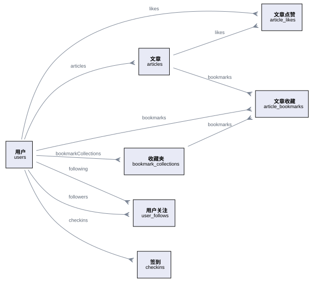

# 互动、收藏与关注设计图

[模块图册](./README.md) · [模块设计](../../1.2/interactions.md) · [服务端路由](../../../apps/api/features/community/interactions.ts)

## 泳道图

## 业务流程图

## 数据表设计图

[打开双语表关系 SVG](./interactions.svg)

