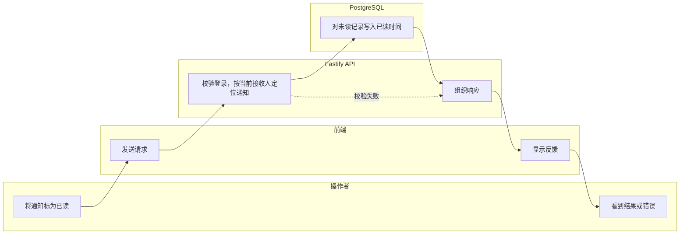
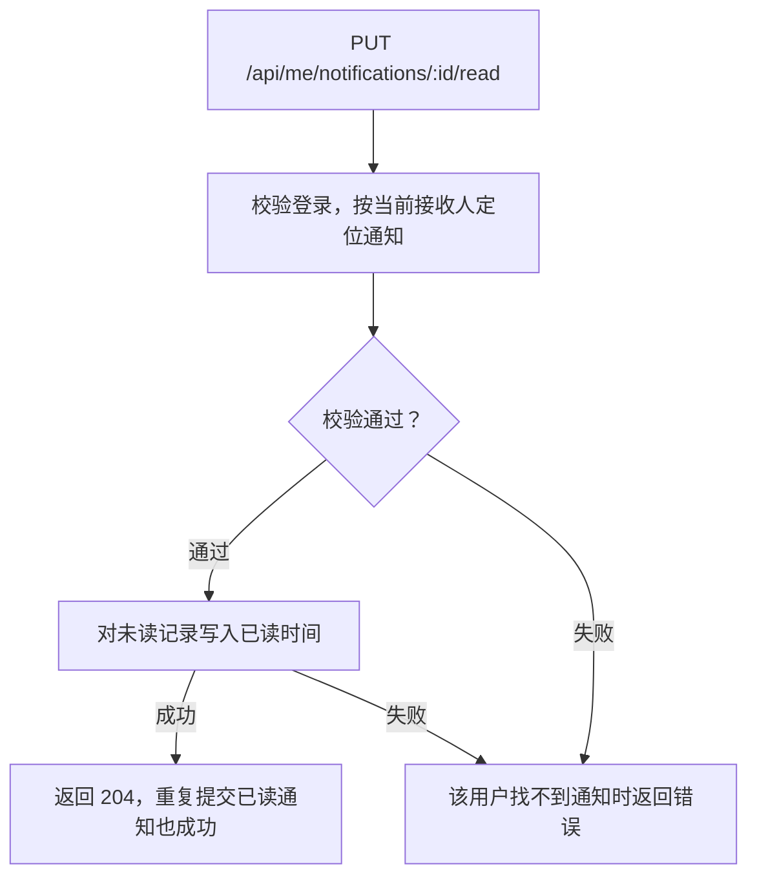
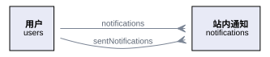

# 站内通知设计图

[模块图册](./README.md) · [模块设计](../../1.2/notifications.md) · [服务端路由](../../../apps/api/features/community/notifications.ts)

## 泳道图

## 业务流程图

## 数据表设计图

[打开双语表关系 SVG](./notifications.svg)

